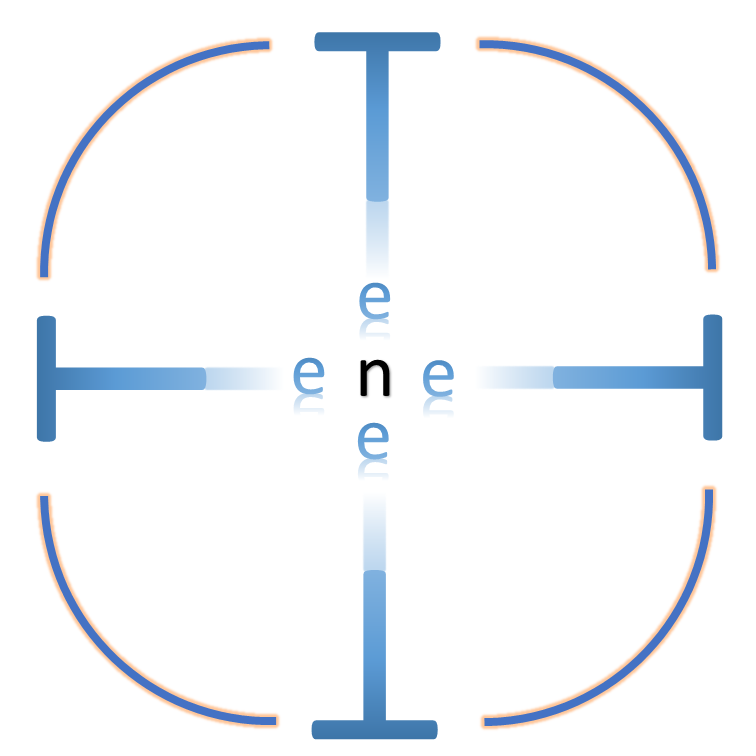

<!-- # TeneT -->
<div align="center">

<h1>TeneT.jl</h1>
<p><b>Differentiable tensor-network contraction and gradient-based iPEPS optimization in Julia</b></p>

[](https://github.com/XingyuZhang2018/TeneT.jl/actions/workflows/ci.yml)
[](https://codecov.io/gh/XingyuZhang2018/TeneT.jl)
[](LICENSE)

</div>

TeneT.jl finds ground states of two-dimensional quantum lattice models with infinite projected
entangled-pair states (iPEPS). The energy is evaluated from a boundary contraction (VUMPS, or a
QR-based CTMRG). Its gradient comes from reverse-mode automatic differentiation through the last
steps of that contraction, with hand-written adjoints for the expensive kernels. LBFGS then
optimizes the iPEPS at a fixed bond dimension D, stage by stage over a ladder of boundary bond
dimensions χ. The same machinery contracts classical 2D partition functions and optimizes 3D
transfer-PEPO problems. TeneT.jl runs on a laptop CPU, a single NVIDIA GPU or an MPI multi-GPU
cluster.

It is aimed at researchers who know iPEPS and boundary-MPS methods and want a differentiable
reference implementation they can read and modify. The repository also ships
[**agent skills**](#agent-skills) that help an AI coding agent choose hyperparameters and plan,
restart and diagnose optimizations according to the maintainer's run policy.

> [!IMPORTANT]
> **TeneT.jl is a research prototype, and its main value is methodological.** It shows, with parity
> tests and dated design notes, how to build differentiable iPEPS optimization end to end:
> symmetry-adapted VUMPS variants, a layered checkpoint API for the AD tape, a contraction-chain
> engine with hand-written adjoints, and 1D/2D-distributed multi-GPU contractions.
>
> It is **not** the optimal solution for production-scale multi-GPU runs. Its gradients come from
> Zygote.jl reverse-mode AD unrolled through the last VUMPS steps. Zygote's pullbacks hold every
> forward intermediate until the backward pass and cannot release them early. Julia returns GPU
> buffers to the memory pool only when the garbage collector runs, unless the code frees them by
> hand. At large bond dimensions, memory rather than FLOPs therefore decides what fits. The
> workarounds cost run time or development effort: recompute checkpointing, `GC.gc()` and
> `CUDA.reclaim()` between passes, and hand-written adjoints with explicit frees. Multi-GPU
> scaling of the full gradient stays well below linear; see
> [Performance and limitations](#performance-and-limitations).

## Features

- **Gradient-based iPEPS optimization.** `optimise_ipeps` runs LBFGS over a χ ladder, with
  energies and gradients from AD through the boundary solve. Runs resume from saved iPEPS
  snapshots, LBFGS state and boundary environments.
- **Models, lattices and boundary algorithms.**
  - Boundary algorithms: VUMPS in `General`, `Plaquette` and `C4v` modes, and a QR-based CTMRG.
  - Quantum models: Heisenberg, J1-J2, J1-J2′, J1-J2-J3, Kitaev and transverse-field Ising, on
    square, honeycomb and kagome lattices.
  - Classical models: the 2D Ising model and 3D close-packed dimers.

  See the [support table](#models-lattices-and-boundary-algorithms) for which combinations work.
- **Observables.** Energy per bond, magnetization, correlation length, transfer-matrix spectra on
  brick-wall honeycomb lattices, and convergence and lattice plots.
- **Memory control for AD.**
  - `Plain`, `Recompute`, `OffloadRecompute` and `Offload` checkpointing for the VUMPS steps and
    the energy.
  - `forloop_iter` chunking.
  - A contraction-chain engine that frees intermediates eagerly and uses hand-written adjoints.
- **Hardware.**
  - CPU (`Array`) and NVIDIA GPU (`CuArray` with cuTENSOR).
  - MPI multi-GPU through `slice1D` (split each contraction across ranks) and `slice2D`
    (block-distribute the χ×χ environments), with an opt-in NCCL path.
  - AMD `ROCArray` dispatch exists but is untested.
- **Agent skills.** Markdown playbooks, not library code, that guide AI coding agents on
  hyperparameters, memory tuning and restarts, plus a template for HPC job operations.

## Installation

```julia-repl
pkg> add TeneT@0.2 OptimKit
```

You need OptimKit only to configure the optimizer yourself, as the quick start does. TeneT 0.2 is
a breaking rewrite of the 0.1 API (see [What's new in 0.2.0](#whats-new-in-020)). If Pkg reports
that no 0.2 version of TeneT exists, 0.2 has not reached the General registry yet. Install it from
GitHub instead:

```julia-repl
pkg> add https://github.com/XingyuZhang2018/TeneT.jl OptimKit
```

- **Julia version.** TeneT needs Julia ≥ 1.11; Julia 1.10 is not supported. It is developed on 1.11, and CI also tests the latest release.
- **Heavy dependencies.** `using TeneT` loads CUDA.jl, cuTENSOR, AMDGPU.jl, MPI.jl and CairoMakie,
  so the first precompilation takes a while.
- **No GPU needed for CPU runs.** On machines without ROCm, AMDGPU.jl prints harmless
  "… is unavailable" warnings at load time.
- **GPU and MPI runs.** Add the packages your script loads directly:
  - `pkg> add CUDA` for `using CUDA` and `atype = CuArray`
  - `pkg> add MPI` for multi-GPU runs

To run the examples and tests, clone the repository and instantiate it. No `Manifest.toml` is
shipped. Inside the clone, CUDA, MPI and OptimKit are already available.

```bash
git clone https://github.com/XingyuZhang2018/TeneT.jl
cd TeneT.jl
julia --project=. -e "using Pkg; Pkg.instantiate()"
```

## Quick start

This example optimizes the spin-½ Heisenberg antiferromagnet on the square lattice on the CPU. It
uses a single-site C4v-symmetric iPEPS with D = 2 and boundary dimension χ = 16.

```julia
using TeneT
using OptimKit: LBFGS, HagerZhangLineSearch   # optimizer types come from OptimKit
using Random

Random.seed!(42)

D, χ = 2, 16
folder = joinpath(@__DIR__, "quickstart_data")   # all output goes here

model  = Heisenberg(lattice=Square(), S=0.5, Jx=1.0, Jy=1.0, Jz=1.0)
params = GradientOptimize(
    model        = model,
    pattern      = [1;;],          # 1×1 unit cell (VUMPS{C4v} uses a single site)
    boundary_alg = VUMPS{C4v}(),   # C4v-symmetric VUMPS with default settings
    optimizer    = LBFGS(200; maxiter=20, gradtol=1e-7,
                         linesearch=HagerZhangLineSearch(maxfg=5)),
    folder       = folder,
)

A0 = init_ipeps(; atype=Array, etype=Float64, D, χ, params)   # random start
A, e, g, nfg, history = optimise_ipeps(A0, [χ], params;
                                       restriction_ipeps=C4v_restriction)
println("final energy per site = ", e)
```

`Heisenberg` keeps its default `ifrotate=true`, which rotates every second spin by π. The Néel
state then becomes a translation-invariant single-site ansatz.

Each LBFGS iteration prints a summary line like this one and appends it to `D2/history.log`:

```text
i =    20   t = 62.89 sec   energy_χ16 = -0.660231086013910   gnorm = 8.130e-05   Eimag = 2.189e-18
```

- **Other output.** Every energy-and-gradient evaluation also prints `energy = …` and its forward
  and backward times.
- **`Eimag`.** This is |Im E| for complex tensors and the indicator |⟨iSʸ⟩| for real ones. When it
  exceeds `imag_tol = 1e-8`, the current χ stage ends.
- **Accuracy.** After 20 iterations the energy is within 1e-8 of the converged D = 2, χ = 16
  value, -0.660231093 per site.
- **Run time.** About 1.5 minutes on a workstation CPU, mostly spent compiling the first
  energy-and-gradient call.
- **Expected warnings.** A fresh run warns that no saved environment was found and that LBFGS
  stopped at `maxiter`.

**Output.** `optimise_ipeps` writes these files under `folder`:

```text
D2/history.log                  one line per LBFGS iteration
D2/ipeps/χ16/No.<iter>.jld2     iPEPS parameters (key "bcipeps"), every `save_every` iterations
D2/lbfgs_checkpoint/χ16.jld2    LBFGS state (ifsave_lbfgs = true by default)
D2/environment/χ16.jld2         boundary environment (only with ifsave_env = true)
D2/observable/χ16.log           energy, bond energies, magnetization, correlation length, plus plots
```

Always set `folder`. The default, `joinpath(pkgdir(TeneT), "data")`, points inside the package
directory.

**Continuing and measuring.**

- **Resume a run.**
  - Keep the same `folder`, set `ifload_lbfgs = true`, and raise the LBFGS budget, for example
    `LBFGS(200; maxiter=40, …)`. `maxiter` counts iterations across segments, so a resumed run
    with the quick start's value of 20 stops at once.
  - Load the last snapshot with `A = init_ipeps(; No=20, D, χ, params)`. LBFGS continues at
    iteration 21 with its quasi-Newton history.
  - Without `ifload_lbfgs`, numbering restarts at `No.1` and overwrites earlier snapshots. Use a
    new `folder` for an independent run.
- **Raise χ.**
  - Pass a ladder such as `optimise_ipeps(A, [16, 24, 32], params; restriction_ipeps=C4v_restriction)`.
  - Or use `default_χlist(D)`. It starts at 2D² and continues through the larger members of 2, 3,
    4, 6, 8, 12, 16, 24, …; for D = 2 that gives 8, 12, 16, 24, ….
  - The ladder stops early once the energy at the next χ changes by less than 1e-7 and the
    gradient norm is below 1e-5.
- **Measure a saved state.** Pass the same `restriction_ipeps` you used for the optimization:

  ```julia
  # D, χ and params as in the quick start (same folder)
  A = init_ipeps(; atype=Array, No=20, D, χ, params)   # loads D2/ipeps/χ16/No.20.jld2
  (E, E_bonds), (M, M_sites), ξ = observable(A, 32, params; restriction_ipeps=C4v_restriction)
  ```

  `observable` converges a χ = 32 environment, writes `D2/observable/χ32.log` and redraws the
  plots. It warns that no χ = 32 environment was saved; that is expected. The keyword
  `cor_len_method` selects the correlation-length estimator: `:mps` (the default), `:channel` or
  `:none`.

**Contraction only.** This example contracts the classical 2D Ising model at β = 0.43 and compares
the free energy with Onsager's exact result:

```julia
using TeneT
model = Ising(lattice=Square(), beta=0.43)
M   = MPO(model, C4v)
alg = VUMPS{C4v}(maxiter=200, miniter=1, maxiter_ad=1, miniter_ad=1, power_iter=10)
rt  = init_env(M, 64, alg)
rt, err = leading_boundary(rt, M, alg)
f_vumps = free_energy(rt, M, alg, model).f
f_exact = exact_free_energy(model)              # Onsager
@show f_vumps f_exact abs(f_vumps - f_exact)    # difference ≈ 1e-9
```

## Agent skills

**Bundled guidance for hyperparameter selection and optimization.** TeneT.jl ships two agent
skills in [`skills/`](skills/). They are Markdown playbooks, not library code. Once you install
them, an AI coding agent such as Claude Code or OpenAI Codex loads them when you ask it to plan,
run or debug a TeneT.jl calculation. They record the run-design experience behind this package:

- which contraction mode and restriction to start from
- how to choose χ ladders and grow D
- what to do when memory runs out
- how to restart without losing optimizer state
- how to read a stalled optimization

With them, the agent starts from the code's defaults and the shipped examples instead of guessing.

| Skill | What it covers | Invocation |
|---|---|---|
| [`tenet`](skills/tenet/SKILL.md) | Run design and hyperparameters: example and contraction choice, χ/D schedules, VUMPS settings, memory tuning, environment/LBFGS restart policy, diagnostics, observable-only and transfer-matrix-spectrum runs | Loads automatically when a request matches. Call it explicitly with `/tenet` (Claude Code) or `$tenet` (Codex). |
| [`tenet-hpc`](skills/tenet-hpc/SKILL.md) | Optional cluster operations: local smoke gate, preflight checks, matching Slurm resources to the parallel layout, provenance, safe cancellation | Install only if you need it. In Codex it runs only when called as `$tenet-hpc`. |

**What `tenet` tells the agent:**

- **Start from the closest example.** Reuse the contraction mode, `pattern` and
  `restriction_ipeps` of the nearest script in `examples/`. Classify the job as a fresh run, χ
  continuation, D upgrade, observable-only run or retry.
- **χ schedule.** Use `default_χlist(D)` for fresh runs, and an explicit list such as `[1024]` to
  continue a converged state.
- **D growth.**
  - Use `init_ipeps_SU(; No, D, D_new, χ, params)` at `SUτ = 0.1`, then set `SUτ = 0.0` and
    `ifSU = false` before optimizing.
  - Expect a transient energy rise at large D.
  - Brick-wall lattices are an exception; see [Known issues](#known-issues).
- **VUMPS settings.** Keep `ifsimple_eig = true` and the power-iteration defaults (5, 5 and 40).
  The taped depth `maxiter_ad` is separate from the forward `maxiter`.
- **Memory.**
  - Follow the [out-of-memory ladder](#checkpointing-and-chunking).
  - Use a GPU for D ≥ 5.
  - For D ≤ 8 and χ ≤ 512, stay on one GPU unless measured memory or throughput calls for more.
- **Environment gate.** Before every optimization segment, converge and save the target-χ
  environment in a separate run, with at most 50 VUMPS steps and err ≤ 1e-6. Then optimize with
  `ifload_env = true`.
- **Restarts.**
  - Keep `ifsave_lbfgs = true`.
  - Resume with `ifload_lbfgs = true` and the matching `No.N.jld2`.
  - Save environments with `ifsave_env = true`, which is off by default.
  - Never continue from an iterate that was not saved.
- **Diagnostics.**
  - After each segment, the agent plots the accepted energies from `history.log` into
    `energy_vs_iter.png` and `.tsv`, and recommends continuing, stopping or diagnosing.
  - When the gradient norm stalls, it suspects χ first, especially for non-Hermitian problems.
- **Guardrails.** The agent asks before it changes a default value in TeneT.jl's source, examples
  or run templates. It reports unsupported features instead of working around them.

**Installing.** Opening the repository does not load the skills. Link the folders into your
agent's skills directory. Run these commands from the repository root; `-sfn` lets a re-run
replace an old link:

```bash
# Claude Code: personal skills (or <project>/.claude/skills/ for a single project)
mkdir -p ~/.claude/skills
ln -sfn "$PWD/skills/tenet"     ~/.claude/skills/tenet
ln -sfn "$PWD/skills/tenet-hpc" ~/.claude/skills/tenet-hpc    # optional

# OpenAI Codex: ~/.agents/skills/ (older releases read ~/.codex/skills/)
mkdir -p ~/.agents/skills
ln -sfn "$PWD/skills/tenet"     ~/.agents/skills/tenet
ln -sfn "$PWD/skills/tenet-hpc" ~/.agents/skills/tenet-hpc    # optional
```

- **Windows.**
  - Use PowerShell rather than Git Bash, because Git Bash's `ln -s` copies the folder. Create the
    parent folder, then run
    `New-Item -ItemType Junction -Path "$HOME\.claude\skills\tenet" -Target "$PWD\skills\tenet"`.
    No administrator rights are needed.
  - A copied folder does not follow `git pull`, so copy it again after updating.
- **Codex.** It reads `skills/<name>/agents/openai.yaml` for the display name, default prompt and
  invocation policy.
- **Claude Code.** It ignores `agents/openai.yaml`, so an installed `tenet-hpc` can load
  automatically. Add `disable-model-invocation: true` to its `SKILL.md` frontmatter to make it
  manual-only.
- **Adapting a skill.** A linked skill is the repository file itself, so copy the folder instead
  of linking it if you want to change it.

**Example prompts:**

- `/tenet` *Plan the D = 5 upgrade of my converged D = 4 TeneT.jl square-lattice J1-J2 Plaquette
  state (`No.150` at χ = 64) on one 80 GB GPU: initialization, χ list, checkpoint and
  `forloop_iter` settings, and which environment and LBFGS files to load.*
- `$tenet` *My D = 6 TeneT.jl Kitaev run has had gnorm ≈ 3e-4 for 40 iterations at χ = 72. Is χ
  the bottleneck? Propose the next segment.*

**Caveats:**

- **Policies, not library limits.** The skills encode the maintainer's operating policy. Unless you
  approve otherwise, the agent applies two rules:
  - it caps forward VUMPS iterations at 50 per solve, counted across segments and retries of the
    same state
  - it requires a converged environment (err ≤ 1e-6) before every optimization segment

  The library enforces neither. `VUMPS` defaults to `maxiter = 30` and `tol = 1e-10`, and
  `optimise_ipeps` measures each χ stage with `opt_obs_maxiter = 3 × maxiter` (90) VUMPS steps.
  The Ising example above uses `maxiter = 200`. Edit `skills/<name>/SKILL.md` to match your own
  workflow.
- **The environment gate needs a script you provide.** The "env-only wrapper" the skill refers to
  is the maintainer's and does not ship, so the agent writes one.
  - Set the boundary algorithm's `verbosity ≥ 2` so each solve logs its error.
  - Set `ifsave_env = true` so the environment is saved.
  - `observable()` does not save `slice2D` environments.
- **Both skills assume the maintainer's setup.**
  - For cluster work they defer to a user-global `$hpc` skill and an `AGENTS.md`, neither of which
    ships.
  - `tenet` also looks for earlier runs under `hpc/rendered/`, which does not ship.
  - Both link to a monitor-layout file that does not ship.
  - `tenet-hpc` names the maintainer's clusters and local paths, so treat it as a template.
- **The checks run in the agent, not the library.** With `ifload_env = true` (the default), a
  missing or unreadable environment file is replaced by a fresh environment and the run continues,
  with only a warning. A failed LBFGS load likewise starts a new history.

## Models, lattices and boundary algorithms

| Model | Lattice | Boundary algorithms with an energy |
|---|---|---|
| `Heisenberg` | `Square()` | `VUMPS{General}`, `VUMPS{Plaquette}`, `VUMPS{C4v}`, `QRCTMRG{C4v}` |
| | `Honeycomb(:brickwall_h)` | `VUMPS{General}` |
| | `Honeycomb(:c3v)` | `QRCTMRG{C3v}` |
| | `Kagome(:merge)`, `Kagome(:onehole)`, `Kagome(:onehole_real)` | `VUMPS{General}` with `ifrotate=false` |
| `J1J2` | `Square()` | `VUMPS{General}`, `VUMPS{Plaquette}`, `VUMPS{C4v}`, `QRCTMRG{C4v}` |
| | `Honeycomb(:brickwall_h)` | `VUMPS{General}`, `VUMPS{Plaquette}` |
| | `Honeycomb(:merge)` | `VUMPS{General}` with `ifrotate=false` |
| `J1J2p` (J1-J2′) | `Honeycomb(:brickwall_h)`, `Honeycomb(:brickwall_v)` | `VUMPS{General}`; on `:brickwall_v` also one-sided |
| | `Honeycomb(:merge)` | `VUMPS{General}` with `ifrotate=false` |
| `J1J2J3` | `Honeycomb(:brickwall_h)`, passed explicitly (the default `Square()` has no energy) | `VUMPS{General}`, `VUMPS{Plaquette}` |
| `Kitaev` | `Honeycomb(:brickwall_h)` | `VUMPS{General}` |
| `FWavePRVB` (experimental) | `Honeycomb(:brickwall_h)` | `VUMPS{General}` |
| `TFIsing` | `Square()` | `VUMPS{C4v}` |
| `Ising` (classical 2D) | `Square()` | `VUMPS{C4v}` with `MPO(model, C4v)`, or `VUMPS{General}(ifupdown=false)` with `MPO(model)`: contraction and free energy |
| `CubicDimer` (classical 3D) | square transfer layer | `VUMPS{General}`, `VUMPS{C4v}`: transfer-PEPO optimization |

**Contraction modes.** The mode is the `F` in `VUMPS{F}`.

- **`General`** handles any `Ni×Nj` unit cell given by `pattern`, where repeated numbers mean the
  same tensor.
  - By default (`ifupdown = true`) it converges the upper and lower boundaries separately.
  - `ifupdown = false` reuses the upper boundary and is valid only for up–down-symmetric states.
    Combined with a model trait, this is the one-sided mode used for `J1J2p` on
    `Honeycomb(:brickwall_v)`.
- **`Plaquette`** (`VUMPS{Plaquette{Square}}()` or `VUMPS(Plaquette(lattice))`) targets 2×2 or 2×6
  unit cells whose tensors are related by reflections, and computes left environments only.
  - Impose the reflections through `restriction_ipeps`, as the examples do.
  - Its energies need the default `ifrotate = true`.
- **`C4v`** contracts a single C4v-symmetric tensor (`pattern = [1;;]` with `C4v_restriction`).
- **`QRCTMRG{C4v}` and `QRCTMRG{C3v}`** are QR-based single-site CTMRG for real tensors.

**Gradients.** Each boundary solve runs up to `maxiter` steps without AD, stopping early once the
error is below `tol`, then `maxiter_ad` taped steps. The VUMPS defaults are 30 and 4. The gradient
back-propagates through the taped steps only, so it is unrolled, not an implicit fixed-point
derivative.

**Tensors and symmetry.**

- **Element types.**
  - iPEPS tensors are dense `Float64` or `ComplexF64`.
  - QRCTMRG needs real tensors.
  - `Float32` is available only as an experimental working precision: `inner_etype`, or
    `whole_vumps_etype` for the whole VUMPS step.
- **Spin.** All examples use S = ½, and the sublattice rotation `ifrotate = true` is exact only for
  S = ½.
- **`restriction_ipeps`.** This is a Zygote-differentiable function `A -> A′` applied to the raw
  parameter array before every contraction.
  - On the square lattice the array has shape `(D, D, D, D, d, Nsites)`, with legs
    `(left, down, right, up, physical)`. Other lattices differ; see
    [`src/ipeps_optimize/init.jl`](src/ipeps_optimize/init.jl).
  - `C4v_restriction` can be passed directly.
  - The gauge fix `local_min_norm(A, params)` also needs the parameters, for example
    `restriction_ipeps = A -> local_min_norm(C4v_restriction(A), params)`.

### Known issues

- **D growth on some lattices.** `init_ipeps_SU` currently mis-maps the odd-sublattice tensors of
  brick-wall honeycomb states. It throws on `Honeycomb(:merge)` and one-hole kagome. Grow D on
  these lattices with `init_ipeps_perturbation`.
- **Experimental parts.** `QRCTMRG{C3vTwoSite}` does not work yet, and `FWavePRVB` is
  experimental.
- **Untested parts.** The TFIsing, Kitaev, J1-J2-J3, FWavePRVB and kagome energies are exercised
  only by examples, with no unit tests. `ROCArray` is untested.

## Examples

`examples/` holds one script per model, lattice and boundary algorithm, mostly named
`<Model>_<Lattice>_<Algorithm>_<Mode>.jl`; for example,
`examples/Heisenberg/Heisenberg_Square_VUMPS_C4v.jl`. Run one from the repository root with
`julia --project=. examples/<path>`.

- **Classical.**
  - `2D_Classical/Ising_Square_VUMPS_C4v.jl`: contraction only, with the free energy compared to
    Onsager's.
  - `3D_Classical/CubicDimer_D2_chi16_VUMPS_C4v.jl`: transfer-PEPO optimization and the residual
    entropy.
- **Quantum.** `Heisenberg/`, `J1J2/`, `J1J2p/`, `J1J2J3/`, `Kitaev/`, `TFIsing/` and `FWavePRVB/`
  cover the combinations in the table above. Two scripts stand out:
  - `Heisenberg/Heisenberg_Square_VUMPS_C4v_f32_smoke.jl` exercises Float32 inner precision.
  - `J1J2p/J1J2p_tm_spectrum_sofia.jl` computes a transfer-matrix spectrum. It needs a GPU, a saved
    checkpoint and command-line arguments.
- **Multi-GPU.** `MPI_parallel/` holds distributed drivers, Slurm scripts for three clusters,
  validation scripts and benchmark reports.

The scripts are research templates:

- Most start on the CPU at D = 2, χ = 16. About half then climb a χ ladder, to χ = 384 or
  open-ended, with 10–200 LBFGS iterations per stage. A few use reduced smoke settings.
- **Quick try.** Set `χlist_opt = [χ_init]` and use a small LBFGS `maxiter`.
- **Real runs.** Switch `atype` to `CuArray` and set D, the χ list and the iteration budgets
  yourself. `J1J2/J1J2_Honeycomb_VUMPS_Plaquette.jl` already uses `CuArray`.
- **Output location.**
  - The examples write under `joinpath(pkgdir(TeneT), "data", …)`. Change `folder` if TeneT is
    installed as a package.
  - On Windows, keep the base path short, because the folder names include the full model
    description.
- **Saved iterates.** Several scripts set `No ≠ 0` to continue from a saved iterate that is not
  shipped: TFIsing, J1-J2 square C4v, the J1-J2 and J1-J2-J3 honeycomb Plaquette scripts, and
  Kitaev. Set `No = 0` to start from a random state.

## Scaling up: memory and multiple GPUs

### Checkpointing and chunking

Each `CheckpointMethod` trades memory for time in a different way:

- `Plain()` keeps the AD tape.
- `Recompute()` reruns the forward pass during the backward pass.
- `OffloadRecompute()` parks the inputs in host memory, then recomputes.
- `Offload()` moves the captured GPU tensors to the host without recomputing.

| Field | Wraps |
|---|---|
| `VUMPS.step_checkpoint` | each taped VUMPS step of the `maxiter_ad` loop |
| `VUMPS.subop_checkpoint` | `leftenv`, `rightenv`, `ACenv` and the QR step inside a step (`General` and `Plaquette`; ignored by `C4v`) |
| `VUMPS.eig_checkpoint` | each power-iteration eigensolve except the corner (C) solve |
| `VUMPS.segment_checkpoint` | 5-step segments of long power iterations (`power_iter > 6`) |
| `VUMPS.inner_checkpoint` | each transfer-map application (`Plain` or `Recompute` only) |
| `QRCTMRG.step_checkpoint` | each taped QRCTMRG step |
| `GradientOptimize.bond_checkpoint` | each bond term of the energy (`Plain` or `Recompute` only) |
| `GradientOptimize.obs_checkpoint` | the whole energy evaluation |

`ifcheckpoint = true` on both `VUMPS` and `GradientOptimize` selects a preset:

- step, subop and segment: `OffloadRecompute`
- eig and bond: `Recompute`
- inner: `Plain`

Fields you set explicitly still win.

`Recompute` reruns the same forward pass, so it reproduces the `Plain` gradient. For the `VUMPS`
fields, the match is bit for bit on the CPU and to a relative 1e-10 in the multi-GPU checks. One
exception: some energy terms start from a random tensor. These are the 2×2 and 2×3 clusters of
`J1J2`, `J1J2p`, `J1J2J3`, `FWavePRVB` and the one-hole kagome `Heisenberg`.
With `bond_checkpoint` or `obs_checkpoint` set to `Recompute()`, that tensor is drawn again in the
backward pass. The gradient then matches `Plain` only up to the run-to-run variation of that
random start.

`forloop_iter` on `VUMPS`, or on `slice1D`/`slice2D`, splits each boundary contraction into chunks
to cap transient memory. Set `GradientOptimize.forloop_iter` to the same value, because the
preconditioner, magnetization and correlation-length contractions read that field.

**Out-of-memory ladder.** When a run does not fit, apply these steps in order and stop at the
first one that works:

1. `ifcheckpoint = true` on both `GradientOptimize` and `VUMPS`
2. a larger `forloop_iter` (4, 8, 16, …); under `slice1D` the useful maximum is about χ / nprocs
3. `inner_checkpoint = Recompute()`
4. several GPUs: `slice1D` while the replicated environments fit, and `slice2D` when they do not

### Multiple GPUs with MPI

Run one MPI rank per GPU. The setup looks like this:

```julia
using CUDA, MPI, TeneT            # needs `pkg> add CUDA MPI`; load CUDA before MPI on some clusters
MPI.Init()
CUDA.device!(0)                   # each rank sees exactly one GPU

# model, pattern (a 2×2 Plaquette cell) and folder as in a serial script
alg = VUMPS(Plaquette();          # or General()
            parallel_method = slice2D(4, 4; forloop_iter=16),   # 16 ranks on a 4×4 grid
            step_checkpoint = Recompute())
params = GradientOptimize(; model, pattern, boundary_alg=alg,
                          bond_checkpoint=Recompute(), folder)
# then init_ipeps(; atype=CuArray, …) and optimise_ipeps, as in the quick start
```

```bash
# OpenMPI example: one rank per GPU
mpirun -np 16 --map-by ppr:8:node --bind-to none \
  bash -c 'export CUDA_VISIBLE_DEVICES=$OMPI_COMM_WORLD_LOCAL_RANK; exec julia --project your_script.jl'
```

[`examples/MPI_parallel/examples/J1J2_Square_VUMPS_Plaquette_slice2d.jl`](examples/MPI_parallel/examples/J1J2_Square_VUMPS_Plaquette_slice2d.jl)
is a complete driver. It sets the grid through the equivalent legacy field `boundary_alg.grid`.

- **`slice1D(; forloop_iter)`** splits every transfer-map contraction across ranks and all-gathers
  the result.
  - It adds throughput, but every rank still holds full-χ environments.
  - It works with `VUMPS{General}`, `VUMPS{Plaquette}` and `VUMPS{C4v}`. For `C4v` it applies only
    through `optimise_ipeps` and `observable`.
- **`slice2D(N1, N2; forloop_iter)`** block-distributes the χ×χ environments over an `N1×N2` grid
  of `N1*N2` ranks. Use it when peak memory is the blocker. The constructor is collective, so call
  it on all ranks after `MPI.Init()`. Its scope:
  - `VUMPS{General}` with rank-5 iPEPS tensors on any lattice, and `VUMPS{Plaquette}` on
    `Square()` and `Honeycomb(:brickwall_h)`
  - `ifsimple_eig = true`, no mixed precision, no `ifdownfromup` and no one-sided environment
  - validated with `step_checkpoint = Recompute()` and `bond_checkpoint = Recompute()`; the
    `ifcheckpoint` preset is not validated here
  - The energy stays block-distributed for every `VUMPS{General}` model except `J1J2` on
    `Honeycomb(:merge)` and `J1J2p` on `Honeycomb(:brickwall_v)`. Under `VUMPS{Plaquette}` it stays
    distributed only for `J1J2` on `Square()`. Other models gather the full-χ environment to
    evaluate the energy, which can run out of memory at large χ.
- **Overrides.** The method's `forloop_iter` and `inner_etype` replace the `VUMPS` fields of the
  same name.
- **Output.**
  - Only rank 0 writes the logs, iPEPS snapshots and LBFGS state.
  - With `slice2D` and `ifsave_env = true`, every rank writes its block into the shared file
    `environment/χ<χ>.slice2d.jld2` through MPI-IO.
- **NCCL.** `TENET_USE_NCCL=1` sends every eligible GPU collective through NCCL:
  - all-reduces and equal-count all-gathers
  - the `slice2D` row and column collectives, when χ is divisible by `N1` and `N2` (otherwise they
    fall back to MPI)

  It works with `CuArray` only and needs `libnccl` on `LD_LIBRARY_PATH`. It helps for large
  messages and hurts for small ones.
- **Cluster settings.** [`examples/MPI_parallel/README.md`](examples/MPI_parallel/README.md)
  collects the MPIPreferences templates, the UCX and `CUDA_LAUNCH_BLOCKING` settings, and Slurm
  scripts for BSC MareNostrum 5, JSC JUPITER and VUB Sofia. The drivers there use the equivalent
  legacy fields `ifparallel = true` and `boundary_alg.grid`.

## Performance and limitations

Gradients come from Zygote reverse-mode AD, unrolled through the last `maxiter_ad` (default 4)
VUMPS steps after an untaped warm start. In this Julia implementation, device memory, not
arithmetic, decides which D and χ fit, and the workarounds that make them fit cost time.

- **Unrolled AD keeps every taped step alive until the backward pass.**
  - At D = 16, χ = 768 (J1-J2, Plaquette VUMPS, `slice2D` on 16 H200 GPUs), the gradient ran out
    of memory. The four `maxiter_ad` step tapes and the per-bond energy tapes stayed resident.
  - `step_checkpoint = Recompute()` plus `bond_checkpoint = Recompute()` made one
    energy-and-gradient evaluation fit, at 99.6 % of device memory (commits
    [`2d89fb9`](https://github.com/XingyuZhang2018/TeneT.jl/commit/2d89fb9) and
    [`f226f6b`](https://github.com/XingyuZhang2018/TeneT.jl/commit/f226f6b), which call the
    `slice2D` path by its earlier name, `cannon`).
  - At D = 10, χ = 400 on a 64 GB H100, three nested checkpoint layers were needed to fit. The
    backward pass then cost about 4× the forward pass per eigensolver iteration
    ([`docs/MPI_parallel_optimization.md`](docs/MPI_parallel_optimization.md)).
- **Julia frees GPU memory late.**
  - Zygote's pullbacks and `@tensor` temporaries go back to the CUDA pool only when the garbage
    collector runs. In a `slice2D` transfer map at D = 10, χ = 1024 on four H200 GPUs, they left
    more than 60 GiB of dead pool memory per backward call
    ([design note](docs/2026-06-10-slice2d-flmap-design.md)).
  - The transfer-map kernels therefore use hand-written adjoints with explicit frees. Measured on
    one H200, the Zygote-taped kernel ran its backward pass 1.5–1.8× slower at D ≥ 10, and needed
    1.6–2× as many chunks to fit from χ = 768 up
    ([Sofia benchmarks, Part 6](examples/MPI_parallel/benchmarks/Sofia_VUB_H200.md)).
  - The CUDA pool fragments at large χ. `optimise_ipeps` therefore runs a full `GC.gc()` and
    `CUDA.reclaim()` after every forward pass, backward pass and LBFGS iteration whenever less
    than 10 % of device memory is free ([`src/utils/gpu.jl`](src/utils/gpu.jl)).
- **Multi-GPU scaling stays sub-linear.**
  - The boundary solve alone (`leading_boundary` without AD) scales well: 6.3× on 8 H100 GPUs.
  - A full energy-and-gradient evaluation scales less well. The benchmark used D = 10, χ = 400,
    J1-J2, Plaquette VUMPS and `slice1D`, measured before the chain engine became the default
    ([Sofia benchmarks](examples/MPI_parallel/benchmarks/Sofia_VUB_H200.md)):

    | GPUs | Cluster | Speedup over one GPU |
    |---|---|---|
    | 8 H100, two nodes | BSC | 2.6× |
    | 8 GH200, two nodes | JSC | 3.6× |
    | 8 H200, one node | Sofia | 5.25× |
    | 16 H200, with NCCL | Sofia | 6.7× |

  - The backward pass dominates each evaluation: 516 s of 671 s on one H200. Part of that cost is
    recomputing the checkpointed forward. Across nodes the backward is limited by its gradient
    all-reduces; NCCL alone raises the 16-H200 speedup from 5.0× to 6.7×.
  - Memory also dictates the data layout. At D = 16 the replicated layout runs out of memory at
    χ = 624 on a 140 GB H200.
  - The block-distributed `slice2D` layout fits larger χ but pays in communication. Its transfer-map
    forward was 2.7–5.5× slower than `slice1D`'s on 16 GPUs across nodes. Going from 16 to 64 H200
    at χ = 768 makes each VUMPS step only 1.9× faster.
- **The Julia GPU stack needs workarounds.**
  - `CUDA_LAUNCH_BLOCKING=1` is required on the GH200 and H200 systems tested. On GH200 it costs
    about 15–18 %.
  - NCCL is called through a hand-written wrapper.
  - GPU A/B benchmarks must run in fresh processes, because pool fragmentation can distort timings
    5–10×.

Most of these costs come from this implementation (Zygote's tapes, CUDA.jl's memory pool and the
package's own MPI collectives) rather than from the methods. TeneT.jl is best read as a reference
for the methods:

- symmetry-adapted boundary contractions (`C4v`, `Plaquette`, one-sided VUMPS) and differentiable
  VUMPS with truncated AD
- the checkpoint hierarchy and the out-of-memory ladder
- block-distributed (`slice2D`) VUMPS, with rank-uniform collectives, covering:
  - initialization and environments
  - the QR/LQ seams
  - the energy and the preconditioner
- the memory-deterministic contraction-chain engine, with eager frees and hand-written adjoints
- parity-gated validation (`test/`, `oracles/`):
  - the distributed maps, environments, VUMPS step, QR/LQ seams and square-lattice energies are
    checked against serial references
  - the checkpoint wrappers are checked against plain AD
  - the dated notes in `docs/` record what worked and what did not

**Largest runs to date:**

- one energy-and-gradient evaluation at D = 16, χ = 768 on 16 and 64 H200 GPUs (a smoke test, not
  a converged optimization)
- distributed transfer maps up to χ = 1024 on 64 H200
- end-to-end gradient benchmarks at D = 10, χ = 400 on up to 16 GPUs across three clusters

## Testing and validation

```bash
julia --project=. test/runtests.jl              # serial suite, about 8–10 min
julia --project=. -e "using Pkg; Pkg.test()"    # the same suite in Pkg's sandbox, as CI runs it
```

- **Coverage.** The suite runs about 2,200 tests on a machine with a working CUDA GPU, where
  `CuArray` variants are added automatically. CPU-only machines run fewer. AMD GPUs are not
  tested.
- **MPI.** `TENET_TEST_MPI=true julia --project=. test/runtests.jl` adds the MPI collective tests
  on a single rank.
- **Distributed parity.** The `slice2D` parity suites start their own CPU ranks. For example,
  `julia --project=. test/run_test_slice2d_m5.jl` checks the full VUMPS step on 4 ranks.
- **Oracle gates.** Correctness gates are registered in [`oracles/gates.toml`](oracles/gates.toml).
  List them with `julia --project=. scripts/run_oracle_gates.jl --list`. Cluster gates are refused
  unless you pass `--allow-cluster`.

## Documentation and help

- [`docs/`](docs/): dated design documents and reports, in development order. They cover:
  - mixed-precision inner contractions
  - the unified checkpoint API
  - the 2D-distributed VUMPS runtime and its milestones: chain engine, distributed maps,
    environments, `vumps_step`, distributed energy, QR/LQ seams
- [`docs/benchmarks/`](docs/benchmarks/): single-GPU and CPU reports.
- [`examples/MPI_parallel/benchmarks/`](examples/MPI_parallel/benchmarks/): multi-GPU results on
  BSC MareNostrum 5 (H100), JSC JUPITER (GH200) and VUB Sofia (H200).
- [`REPOSITORY_RULES.md`](REPOSITORY_RULES.md): rules for human and agent contributors.
- [`oracles/README.md`](oracles/README.md) and
  [`docs/oracle-and-gate-workflow.md`](docs/oracle-and-gate-workflow.md): the correctness
  references, and which gate to run for which change.
- **API reference.** There is no hosted API documentation. Start from the examples and the
  docstrings, for example `?optimise_ipeps`.
- **Bugs and questions.** Use [GitHub Issues](https://github.com/XingyuZhang2018/TeneT.jl/issues).

## References

TeneT.jl builds on these methods:

- V. Zauner-Stauber, L. Vanderstraeten, M. T. Fishman, F. Verstraete and J. Haegeman, *Variational
  optimization algorithms for uniform matrix product states*,
  [Phys. Rev. B **97**, 045145 (2018)](https://doi.org/10.1103/PhysRevB.97.045145).
- M. T. Fishman, L. Vanderstraeten, V. Zauner-Stauber, J. Haegeman and F. Verstraete, *Faster
  methods for contracting infinite two-dimensional tensor networks*,
  [Phys. Rev. B **98**, 235148 (2018)](https://doi.org/10.1103/PhysRevB.98.235148).
- H.-J. Liao, J.-G. Liu, L. Wang and T. Xiang, *Differentiable programming tensor networks*,
  [Phys. Rev. X **9**, 031041 (2019)](https://doi.org/10.1103/PhysRevX.9.031041).

If you use TeneT.jl in your work, please cite this repository.

## What's new in 0.2.0

0.2.0 rewrites the 0.1 VUMPS contractor from the ground up, in more than 550 commits since 0.1.1.
It turns the contractor into the framework described above:

- a unified gradient optimizer (`GradientOptimize`, `optimise_ipeps`)
- VUMPS in three contraction modes, plus a QR-based CTMRG
- the models and lattices in the support table
- GPU and MPI multi-GPU execution
- a unified checkpoint API and the contraction-chain engine
- observables and transfer-matrix spectra
- the bundled agent skills
- oracle gates for validation

### Breaking changes from 0.1.x

- **0.1 API removed.**
  - `obs_env`, `vumps_env`, `SquareVUMPSRuntime`, `SquareLattice` and `num_grad` are gone.
  - `AbstractLattice` and `VUMPSRuntime` are no longer exported. `VUMPSRuntime` is now an internal
    struct with fields `AL, AR, C, FL, FR`.
  - A boundary solve is now `alg = VUMPS{Mode}(; …)`, `rt = init_env(M, χ, alg)`,
    `rt, err = leading_boundary(rt, M, alg)`.
- **New unit-cell format.** Unit cells are `TeneT.StructArray(tensors, pattern)` objects, which are
  not exported, with an integer `pattern` matrix. Before, they were arrays with trailing `(Ni, Nj)`
  dimensions. Options moved from keyword arguments into the algorithm structs.
- **Old environments do not load.** Environments saved by 0.1 cannot be loaded. 0.2 uses the
  layout `<folder>/D<D>/environment/χ<χ>.jld2`.
- **Dense tensors only.** Tensors are dense `Array` or `CuArray`. The U(1)/Z₂ symmetric tensors
  advertised for 0.1 are not part of 0.2.
- **Dependencies.**
  - Requires Julia ≥ 1.11, CUDA.jl 5, Zygote 0.7 and KrylovKit 0.10.
  - MPI.jl, cuTENSOR, AMDGPU.jl and CairoMakie are now hard dependencies.

## License

MIT; see [LICENSE](LICENSE).
